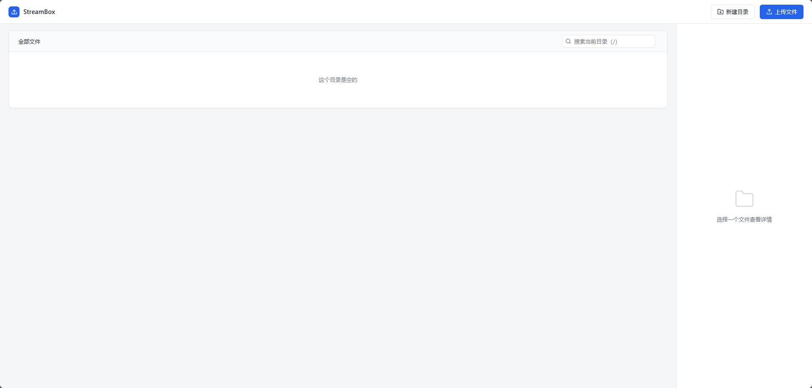

# StreamBox


个人用的流媒体文件服务器。一个 Go 二进制 + 一个 HTML 页面，通过 `go:embed` 打包在一起，丢到机器上就能跑。



## 功能

- **浏览目录**：多层级导航，面包屑 + 键盘 `~` 回根
- **上传文件**：分片上传（4MB/片），支持拖拽、暂停/继续/取消
- **断点续传**：网络断开或主动取消后，重新选同一个文件从断点继续
- **并发限制**：同时最多 3 个上传，其余排队
- **下载文件**：走标准 HTTP `Range`，支持浏览器原生断点续传
- **新建目录**
- **重命名**
- **多选**：Ctrl/Cmd 切换，Shift 范围选择，支持批量下载
- **搜索过滤**：当前目录内按名字实时过滤

## 安装

### 方式一：下载二进制（推荐）

去 [Releases](https://github.com/qwqzy/streambox/releases) 页面下载对应平台的压缩包，解压后直接运行。不用装 Go，不用编译。

### 方式二：Go 安装

装了 Go 1.25+ 的话，一行搞定：

```bash
go install github.com/qwqzy/streambox@latest
```

二进制会装到 `$GOPATH/bin`（通常是 `~/go/bin`）。确保这个目录在 `$PATH` 里，然后就能直接运行 `streambox`。

指定版本：

```bash
go install github.com/qwqzy/streambox@v1.0.0
```

### 方式三：从源码编译

```bash
git clone https://github.com/qwqzy/streambox
cd streambox
go build -ldflags="-s -w" -o streambox
```

## 快速开始

```bash
# 默认监听 127.0.0.1:8080，root 为 ./data
./streambox

# 自定义
./streambox --host 0.0.0.0 --port 9000 --root /mnt/media
```

浏览器打开 `http://127.0.0.1:8080` 即可。

## 命令行参数

| 参数 | 默认值 | 说明 |
|---|---|---|
| `--host` | `127.0.0.1` | 监听地址。默认只监听本机，对外暴露需显式指定 `0.0.0.0` |
| `--port` | `8080` | 监听端口 |
| `--root` | `./data` | 文件存储根目录。不存在会自动创建，必须是目录 |

## 目录结构

```text
streambox/
├── go.mod
├── main.go           # 入口：解析参数、嵌入前端、启动 HTTP 服务
├── handlers.go       # 所有 API handler
├── utils.go          # SafeJoin / SafeName 等路径工具
├── config.go         # Config 结构体、flag 解析
├── web/
│   └── index.html    # 单文件前端（HTML + CSS + JS）
├── data/             # 默认的存储根目录（运行时写入，不嵌入）
│   └── .gitkeep
├── .github/
│   └── workflows/
│       └── release.yml  # 打 tag 自动构建多平台二进制
├── docs/
│   └── screenshot.png
├── .gitignore
├── LICENSE
└── README.md
```

## API

所有路径参数都以 `root` 为基准，用相对路径传递。服务端通过 `SafeJoin` + `SafeName` 双重校验，杜绝路径穿越。

### `GET /api/list`

列出目录内容。

| 参数 | 必填 | 说明 |
|---|---|---|
| `path` | 否 | 相对路径，空表示 root |

响应：

```json
{
  "path": "movies/2024",
  "items": [
    { "name": "big_buck_bunny.mp4", "type": "file", "size": 276445467, "mtime": "2024-12-08 21:14:03" },
    { "name": "posters", "type": "dir", "size": 0, "mtime": "2024-12-08 21:14:03" }
  ]
}
```

### `POST /api/mkdir`

新建目录。

| 参数 | 必填 | 说明 |
|---|---|---|
| `path` | 否 | 父目录相对路径，空表示 root |
| `name` | 是 | 新目录名，单段，不能含分隔符 |

### `POST /api/rename`

重命名文件或目录。

| 参数 | 必填 | 说明 |
|---|---|---|
| `path` | 是 | 旧路径（相对 root） |
| `name` | 是 | 新名字，单段。目标已存在返回 409 |

### `PUT /api/upload`

写入一个分片或完整文件。

| 参数 | 必填 | 说明 |
|---|---|---|
| `path` | 是 | 目标相对路径 |

请求头 `Content-Range: bytes <start>-<end>/<total>`：

- `start == 0` 时服务端会 `O_TRUNC`，从头覆盖
- `start > 0` 时从该偏移继续写，若超过当前文件大小返回 409

响应：

```json
{ "offset": 8388608, "total": 276445467, "done": false }
```

### `HEAD /api/upload`

查询目标文件已写入的字节数，用于断点续传探测。

- 文件存在：`200` + `X-Upload-Offset: <size>`
- 文件不存在：`404`
- 路径非法或是目录：`400`

### `GET /api/download`

下载文件。底层用 `http.ServeContent`，自动处理：

- `Range` / `206` / `Content-Range` / `Accept-Ranges`
- `If-Range` / `If-Modified-Since` / `304`
- `HEAD` 请求

### `HEAD /api/download`

和 `GET` 相同，只返回响应头，不返回 body。

## 断点续传是怎么工作的

**上传**：

1. 每次开始一个新任务，先 `HEAD /api/upload` 询问服务端已写多少字节
2. 和 localStorage 里记的 `{size, mtime}` 比对，一致则认为是同一个文件
3. 从服务端返回的 offset 开始，继续发 4MB 分片
4. 每个分片成功后就更新 localStorage

判断「能不能续」只比对 **文件大小** 和 **最后修改时间**，两项一致才续传。同名但内容不同的文件会自动从头覆盖。

**下载**：

完全交给浏览器。`<a download>` 走原生下载，网络中断后浏览器自己会发 `Range` 请求继续。

## 安全说明

- 默认只监听 `127.0.0.1`，想对外暴露必须显式传 `--host 0.0.0.0`
- **没有内置鉴权**。放到公网前请在前面加一层反代 + Basic Auth，或者不要暴露
- 所有路径都经过 `SafeJoin`，`../` 之类的逃逸会被拒绝
- 目录名和文件名经过 `SafeName` 校验，拒绝控制字符和分隔符

## 已知限制

- 不做删除。服务端只提供浏览、上传、下载、新建、重命名
- 取消上传后服务端会残留部分写入的文件。这不是 bug——是断点续传的代价。下次同名同内容再传会从这里继续
- 没有多用户、没有权限、没有配额
- 没有 TLS。需要的话放在 nginx / caddy 后面

## License

[MIT](LICENSE)

---

## Star History

[](https://star-history.com/#qwqzy/streambox&Date)
